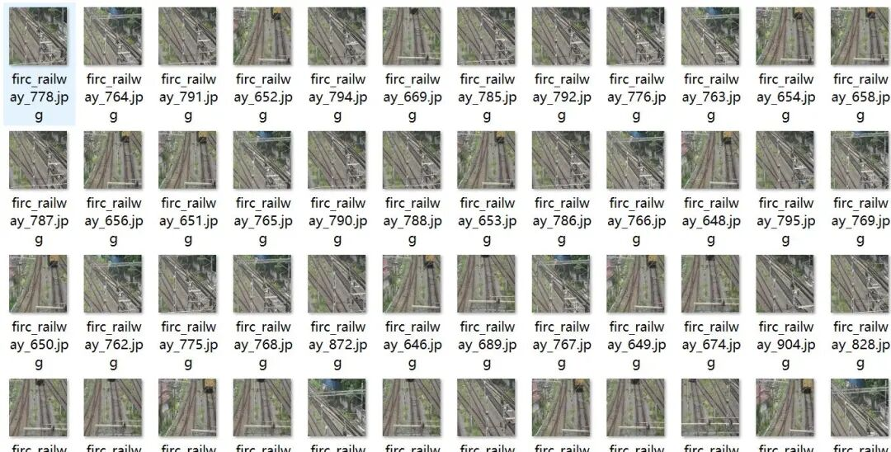
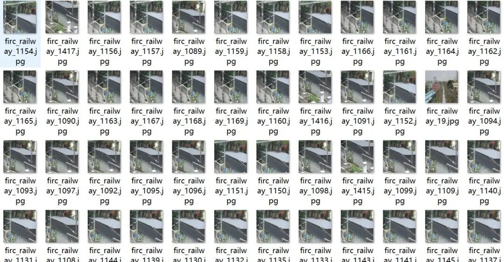
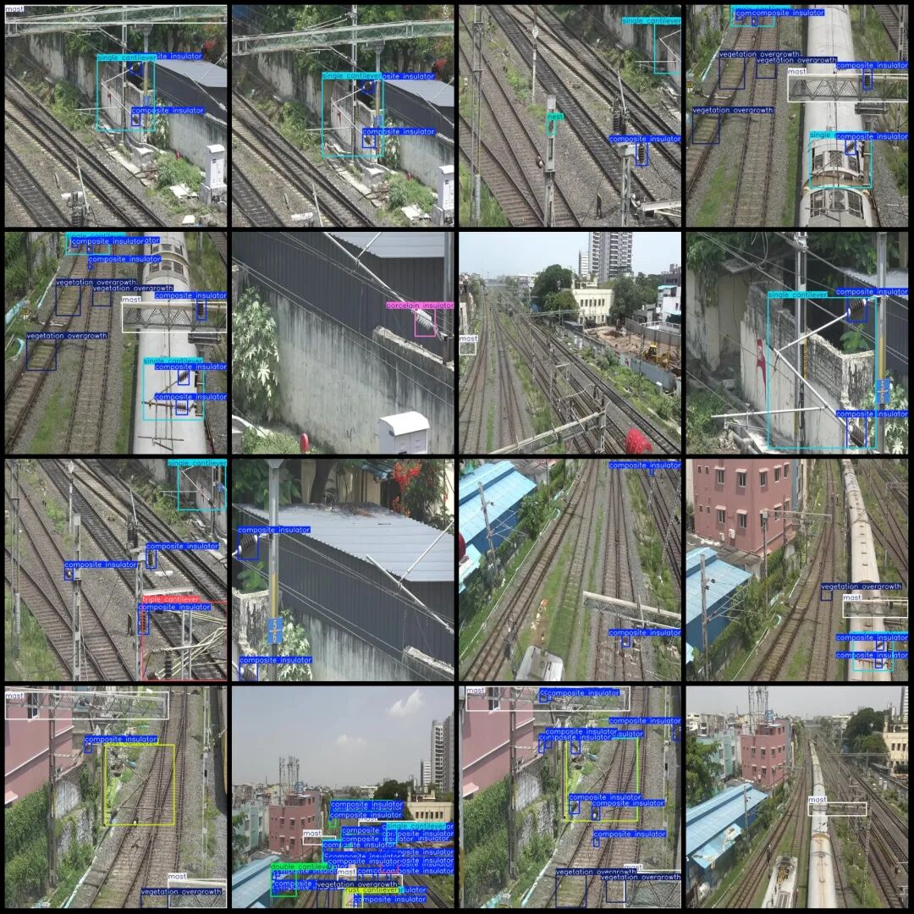
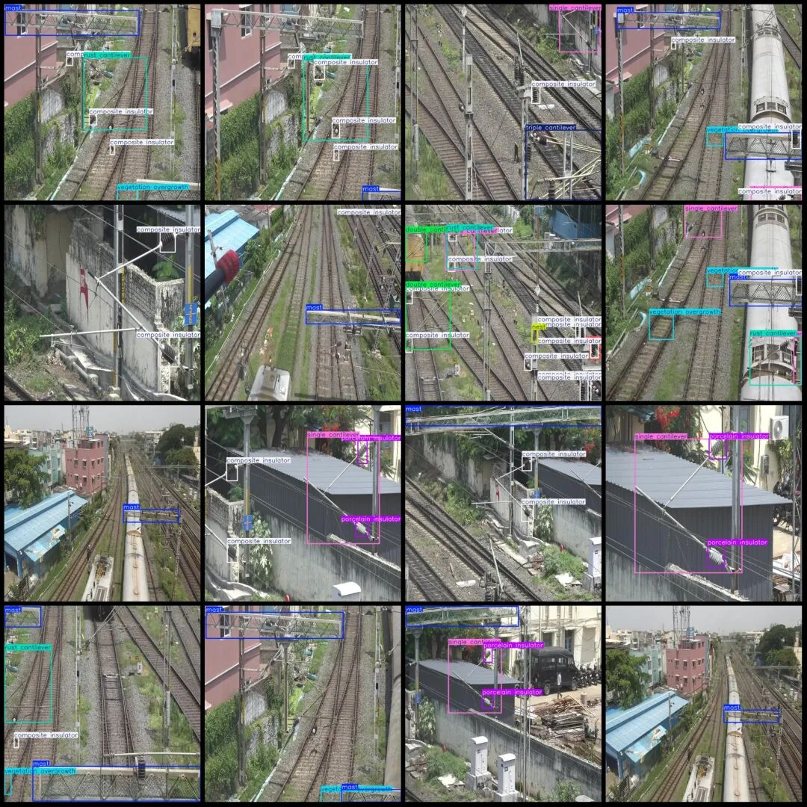

# Intelligent Transportation, Railway Patrol Abnormality Detection Defect Detection Railway Equipment Inspection Dataset - VOC+YOLO format with 1695 images across 10 categories

Dataset format: Pascal VOC format + YOLO format (txt file without split path, only contains jpg images and corresponding VOC format xml files and yolo format txt files)

Number of images (number of jpg files): 1695

Number of annotations (number of xml files): 1695

Number of annotations (number of txt files): 1695

Label category count: 10

Label category names (Note that the order of categories in the YOLO format does not correspond to this, but is based on the labels folder's classes.txt): ["composite insulator", "double cantilever", "flash", "mast", "nest", "porcelain insulator", "rust cantilever", "single cantilever", "triple cantilever", "vegetation overgrowth"]

Number of boxes labeled in each category:

Composite insulator (composite insulator) Frame count = 3063

Double cantilever (double-armed) frame count = 206

Flash (flashing) frame count = 25

Mast (frame) count = 1339

Nest (Bird Nest) Frames = 182

porcelain insulator (Ceramic insulator) Frame count = 567

Rust cantilever (rusted cantilever) frame count = 385

Single cantilever (single-arm) frame count = 955

Triple cantilever (3-arm) frame count = 184

vegetation overgrowth (Overgrowth of vegetation) Frame count = 779

Total frame count: 7685

Image resolution: 640x640

Using labelImg:

Annotation rules: Draw a rectangle around the category.

Important Notice: No

Special : This dataset does not guarantee the accuracy of the trained models or weight files.

Image Preview:

Annotation example:

## Payment

Here is a pay link on Stripe ( https://buy.stripe.com/3cs8yP7sY87d0vu9AB ). Please contact me lonlonago@foxmail.com after funding $89, and I will send you a complete data files , thank you!

